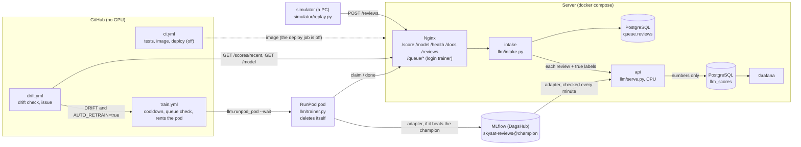

# SkySat architecture

The map of the project: the pieces, how they talk, which command starts what. Model details: [llm.md](llm.md).

## 1. What SkySat does

An airline gets thousands of free-text reviews. SkySat reads one and answers: score out of 10, recommended yes/no, main
complaint. The model is one LoRA adapter on a frozen 1.5B LLM. Passengers' reviews (simulated from the 128k dataset)
arrive at the server's **intake** and wait in a **queue**. A **trainer** on a rented **RunPod GPU** takes batches from
the queue, trains, gates, and registers in **MLflow**. The API serves the **champion**, logs every answer to
**PostgreSQL**, **Grafana** shows it, **drift** is checked on the live reviews' true labels. **CI** tests the code
and builds the image; a drift alarm starts the training by itself (switched on since 17 Nov 2026; how far it has got
is in [section 6](#6-ci-cd-and-the-schedule)). The deploy job is written but off: the server is updated by hand.

## 2. The big picture

Ideas that hold it together:

- **The adapter is not inside the image.** The API asks MLflow which version is `champion` and loads it next to the base
  model it already has. A new model goes live without a redeploy.
- **The queue decouples arriving data from training.** Reviews keep arriving while nothing trains; a batch that fails
  goes back to pending.
- **The GPU is rented only while it trains.** `train.yml` (started by `drift.yml` or by hand), `make train-remote` or
  the intake with `AUTO_TRAIN=1` starts a pod on the cheapest free GPU; the pod deletes itself when the trainer exits,
  and a timer inside the pod deletes it if it does not. With `--wait` (the workflow and `make train-remote`) the
  launcher also deletes the pod on any way out and `--sweep` removes strays; a pod the intake starts has only the first
  two.
- **Review text stays private.** It is in the queue's own schema, which Grafana's user cannot read on the server (the
  local stack's Grafana uses the database owner); monitoring stores numbers only.

## MLOps level

Google's "MLOps: Continuous delivery and automation pipelines in machine learning" names three levels.

| Level | What it asks for | What SkySat has |
|---|---|---|
| 0, manual | Every step by hand: data, training, hand-over to the people who deploy | Not here: the steps are scripts and workflows |
| 1, ML pipeline automation | Training is a pipeline that runs by itself on new data (continuous training), with a gate and a registry | Queue (`llm/queue_db.py`) -> `llm/trainer.py` -> `llm/gate.py` -> MLflow registry, started by `train.yml` |
| 2, CI/CD pipeline automation | The pipeline's own code is built, tested and deployed automatically, and the loop runs without a person | `ci.yml` (tests and image run; the deploy job with rollback is written but off) and `drift.yml` -> `train.yml` (on since 17 Nov 2026) |

What makes it level 2 here:

- A code change goes through tests (`tests/`, `nginx -t`) and an image on ghcr.io. The deploy job (pull on the server,
  smoke test, back to the image that was running if it fails) is written but has never run: there is no self-hosted
  runner and `DEPLOY_TO_RUNNER` is unset, so the server is updated by hand with `az vm run-command`
  ([server.md](server.md#switching-it-on)).
- Drift starts the training: `drift.yml` checks the serving model, opens an issue and, if `AUTO_RETRAIN` is `true`,
  calls `train.yml`, which rents a RunPod pod, trains, gates, and registers in MLflow. The API loads the new champion
  by itself.
- The pipeline itself is tested in CI: `tests/test_pipeline.py` runs the real trainer against a real PostgreSQL with
  only the GPU training replaced by a stub, and checks the queue's state afterwards.
- Cost is bounded: a cooldown, a check that at least 300 reviews are `ready` (pending and already scored by the model
  as live traffic), a 45 minute limit per pod (at most about $0.26 at the dearest GPU type in the list), and a sweep
  that fails the run if a pod is left.

What a real level 2 system has that this one does not:

- No orchestrator such as Kubeflow or Airflow: GitHub Actions plays that part.
- No feature store, and data validation is only the intake's request checks.
- One small server and no staging environment: the new image goes straight to the only server.
- The deploy step is done by hand: the deploy job is off.
- The loop is young: switched on on 17 Nov 2026. On that day the drift check found drift and called the Train workflow by itself, twice; RunPod had
no free GPU either time, so the automatic path has not trained a model yet (the Train workflow did train on RunPod when
started by hand).

## 3. The services (docker-compose.yml)

| Service | What | Port |
|---|---|---|
| `api` | `llm/serve.py`: base model + adapter, one review at a time, `mem_limit` 8 GB, base model cached in the `llm-models` volume | internal 8000 |
| `intake` | `llm/intake.py` (same image): `POST /reviews` -> queue, each live review to `api` with its true labels, `/queue/*` for the trainer | 127.0.0.1:8001 |
| `nginx` | gateway; routes `/score`, `/model`, `/health`, `/docs`, `/scores/recent`, `/reviews`; on the server also `/queue/*` for the `trainer` login | 8080 |
| `mlflow` | local registry (or the shared one from `.env`) | 5050 |
| `postgres` | `llm_scores` (`monitoring/init.sql`) and the schema `queue` | 5432 |
| `grafana` | dashboard `skysat`, anonymous read-only | 3000 |
| `k6` | `make d-loadtest`, 1 user for 1 minute against `/score` | on demand |

On the server, [docker-compose.server.yml](../docker-compose.server.yml) adds Caddy (HTTPS), the login, the rate limit,
the read-only Grafana database user and the restart policies ([server.md](server.md)).

## 4. Life of a model

1. `make simulate-seed N=2000`: 2,000 reviews flown <= 2018 go into the queue (not sent as live traffic).
2. The Train workflow or `make train-remote` (RunPod, RTX 3070 at $0.13/h) or `make llm-train` (this PC): the trainer
   claims the newest pending reviews that the model has already scored (training-only reviews count as scored), keeps
   10% back for the gate, and LoRA-tunes on the rest (1,800 reviews, 322 s on an RTX 4070 Laptop).
3. The gate (`llm/gate.py`): MAE <= 1.0, recommended >= 0.90, complaint >= 0.65. v1 from the queue: 0.88, 92.0%, 71.5%.
4. Logged to MLflow (parameters, metrics, the 17 MB adapter), registered as `skysat-reviews`; it becomes `champion` if
   no champion exists or it beats the champion on the same gate reviews (`combined`). The batch is marked trained if a
   version was registered; if the gate fails it goes back to pending.
5. The API sees the new alias within `MODEL_RELOAD_SECONDS`, loads the adapter, deletes the old one.
6. Drift: `make simulate ... SCENARIO=harsh` sends reviews a harsher survey scored; the live MAE rises past the gate,
   and the next batch (those newest reviews, once scored, trained with `--replay 0 --epochs 3`) gives an adapter that
   beats the champion on them. On the server on 17 Nov 2026 that was version 4 ([llm.md](llm.md#the-gate-and-what-it-measured)).

## 5. Life of a request

`POST /reviews` → Nginx → `intake` → one row in `queue.reviews` (pending). The intake's loop sends it to `POST /score`
with its true labels → `api` (queues behind the lock, generates greedily, parses three lines) → answer (`score`,
`recommended`, `complaint`, `model_version`, `latency_ms`) → one row in `llm_scores` (numbers and fixed labels).
Malformed answers are `null` fields and count as wrong in the live measures.

## 6. CI, CD and the schedule

What has run, as of 17 Nov 2026: `ci.yml` on every pull request and push to `main` (tests and image; never its
deploy job); `drift.yml` by hand; `train.yml` by hand three times, each renting a RunPod GPU, and as a job of the drift
check. The drift check found drift and called `train.yml` twice (17 Nov, 13:12 and 13:38 UTC); both times no
GPU was free and nothing was rented. Not seen yet: a training started by a drift alarm, and a scheduled run of
`drift.yml`.

- `ci.yml`: pytest (no torch; the queue's SQL and `tests/test_pipeline.py` against a PostgreSQL service), `nginx -t` on
  both gateway configs, `docker compose config` for both compose files, build the `llm/Dockerfile` image. It runs for
  pushes and pull requests to `main`. On a push to `main` the image is pushed to ghcr.io and, if the server's runner
  and `DEPLOY_TO_RUNNER` are set, deployed and smoke-tested. Neither is set, so the deploy job has never run: the
  server is updated by hand with `az vm run-command` ([server.md](server.md#switching-it-on)). As written, the deploy
  job remembers the running image and rolls back to it if the smoke test fails (only the image, not the compose or
  gateway files). It does not set the `MLFLOW_*` values itself. It never runs for pull requests.
- `drift.yml`: scheduled hourly at :35. `llm/drift_check.py` asks `/model` which version is serving and judges only that
  version's answers in `/scores/recent?version=N` (`--all-versions` counts all): after a promotion the old model's
  answers no longer count, so a problem that is already fixed does not ask for another retraining. On DRIFT it opens one
  issue "Drift detected: the serving model fell below the gate" and, only if the repository variable `AUTO_RETRAIN` is
  `true`, calls `train.yml` with `--replay 0 --epochs 3`: the new reviews only, because after drift the old labels are
  the problem (with the default, 500 replayed reviews, the retraining of 16 Nov failed the gate; without them it
  passed, see [llm.md](llm.md#the-gate-and-what-it-measured)). A scheduled run with missing secrets is skipped with a
  warning. On 17 Nov 2026 GitHub started no scheduled run for at least seven hours after the workflow reached
  `main` ([server.md](server.md#what-has-run-17-nov-2026)).
- `train.yml` ("Train"): started by `drift.yml` or by hand. It checks its settings, respects a cooldown (variable
  `TRAIN_COOLDOWN_HOURS`, default 6: no automatic run if a GPU was rented less than that long ago, by either workflow,
  whether that training worked or not; a run that found no free GPU rented nothing and does not count; a run started
  by hand skips the cooldown), reads the queue and rents nothing if fewer than 300 reviews are `ready` (pending and
  already scored by the model as live traffic), runs
  `python3 -m llm.runpod_pod --wait --branch main --max-minutes 45`, then `--sweep`, which fails the run if a trainer
  pod is still there, and writes a summary table (queue and serving model before and after, registered, version,
  promoted). One training run at a time (`concurrency: train`).
- `llm/runpod_pod.py --wait` is written to return the trainer's exit code, read from the pod's log, and to write
  `exit_code`, `registered`, `version`, `promoted` for the workflow. RunPod answers 403 to this project's API key on
  the pod-log endpoint (every run of 17 Nov 2026), so the launcher takes the outcome from the server instead: more
  reviews marked trained in `/queue/stats` means a version was registered, a new version in `/model` means it was
  promoted. Without the log a failed gate, too few reviews and a crash look the same: nothing registered, and the run
  ends as failed. A run that registered ends as passed. The launcher deletes the pod on any way out (deadline, Ctrl-C,
  a cancelled workflow, a network error) with three tries, and a network blip does not end the wait. The pod waits
  90 s after the trainer ends so the launcher could read the last log lines.
- If none of the GPU types in `GPUS` is free, the launcher stops with "No GPU had capacity": nothing is rented, the
  run fails, and the next drift check may try again. It happened on 17 Nov 2026 at 13:12 UTC with the six types then
  in the list; the RTX 4090 ($0.34/h) was added as a seventh, tried last, and at 13:38 UTC all seven were out of stock.
- The settings the loop needs (secrets and variables) are listed in [server.md](server.md#switching-it-on).

## 7. Where things live

| What | Where |
|---|---|
| Review dataset | this PC (`data/reviews/`, gitignored); on the server only in the queue |
| Base model | Hugging Face, cached in the `llm-models` Docker volume (server) and on the pod's disk |
| Adapters, runs, metrics | MLflow (`artifacts/llm-runs/mlflow.db` locally, DagsHub when shared) |
| Prediction log | PostgreSQL `llm_scores` |
| Secrets | `.env` (local), `/opt/skysat/.env` and `gateway-users` (server), GitHub secrets, RunPod pod env; never in git |

## 8. Rules that shape the design

- No review text or prompt in git, images, MLflow or the monitoring table.
- Every number in the docs was measured (see [llm.md](llm.md)).
- A new adapter must beat the champion on the same reviews; otherwise the champion stays.
- A pod must never outlive its job: self-delete, an in-pod timer, and the launcher's deadline and sweep
  (`--wait` only: a pod started by the intake has the first two).

## 9. Known limits

- CPU serving takes seconds per review (15-24 s on a laptop) and handles one at a time, so live scoring lags behind a
  fast simulator; the API needs ~8 GB of RAM (the 1 GB server VM of the first version cannot host it).
- Real 2019-2022 drift does not hurt the model, so the drift demo uses the simulated `harsh` scenario.
- The pod clones the code from GitHub: a branch must be pushed before it can train on it.
- A live review can be trained on only after the model has scored it (since 17 Nov 2026), and the server scores
  roughly 0.85 reviews a minute: 300 new reviews are ready for training about six hours after they arrive.
- The automatic loop (`drift.yml` -> `train.yml`) needs the secrets and variables in
  [server.md](server.md#switching-it-on) and `AUTO_RETRAIN=true`. It has been on since 17 Nov 2026. On that day the drift check found drift and called the Train workflow by itself, twice; RunPod had
no free GPU either time, so the automatic path has not trained a model yet (the Train workflow did train on RunPod when
started by hand).
- The pod's log cannot be read with this project's RunPod key (403), so a training that registered nothing ends as a
  failed run without saying why: the gate, too few reviews, or a crash.
- Every GPU type in the list can be out of stock at once; then nothing trains until a later drift check finds one.
- The trainings of 16 and 17 Nov that produced versions 3 and 4 did not run on RunPod: they ran on a Google Colab T4
  started by hand. Colab is not a supported way to train; there is no Colab code in the repository. The RunPod runs
  are in [llm.md](llm.md#runpod-the-trainers-gpu).
- The deploy job has never run (no runner on the server); its rollback restores only the image, not the compose or
  gateway files.
- There is one server and no staging environment.
