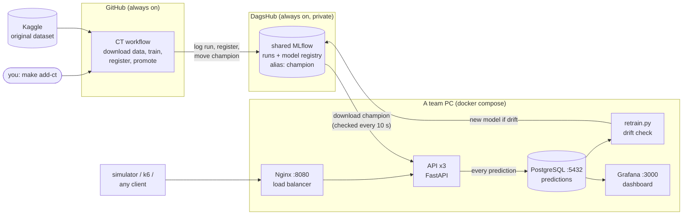
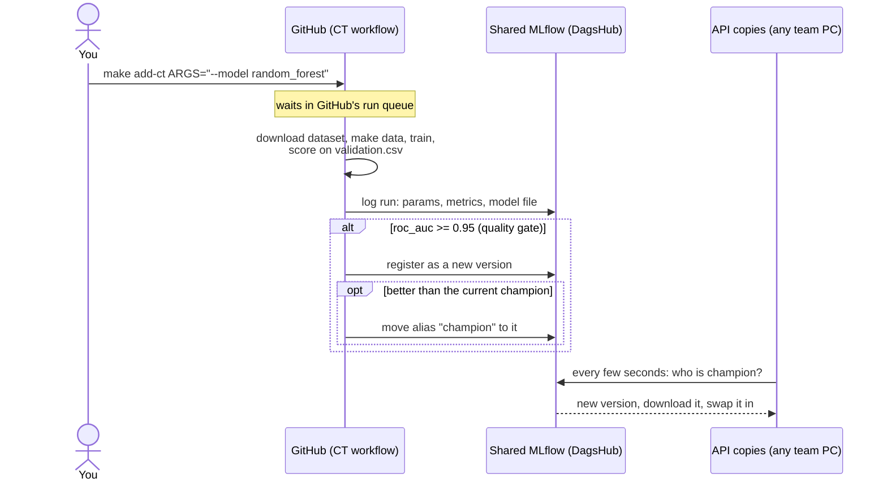
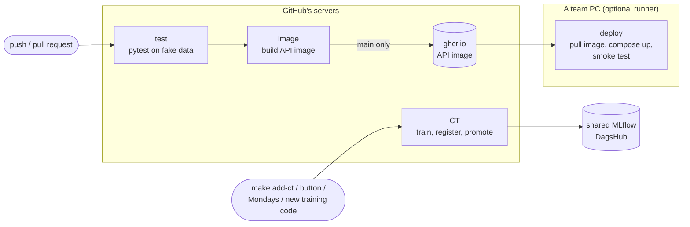

# SkySat architecture

This page is the map of the project: what the pieces are, how they talk to each other, and which command
starts what. The README has the details and measurements of every step; read this page first.

## 1. What SkySat does, in one paragraph

An airline wants to know, right after a flight, whether a passenger is **satisfied**. We train models on a
Kaggle passenger survey, keep every model in **MLflow**, serve the best one (the **champion**) through a
**prediction API**, log every prediction to **PostgreSQL**, watch the results in **Grafana**, detect when the
passengers start to look different (**drift**), and train new models (**CT**). **CI/CD** tests and deploys the
code. Training runs on GitHub's servers; the rest runs in Docker on whichever team PC is in use.

## 2. The big picture



Three ideas hold it together:

- **The model is not inside the API.** The API asks MLflow "who is the champion?" every few seconds and
  downloads it when it changes. So a new model goes live **without restarting or redeploying anything**.
- **One MLflow for the whole team.** Training logs to the shared MLflow on DagsHub, and every team member's API
  reads the champion from it, so everyone sees the same runs and serves the same model.
- **Training does not need anyone's PC.** You ask for a model (`make add-ct`); GitHub queues the request and
  trains it on its own machines, even when every team PC is off.

Without the shared MLflow settings in `.env`, everything falls back to a local MLflow at http://localhost:5050
(the `mlflow` service), which is handy offline but only you can see.

## 3. The services

| Service | What it is | Address | Code | Started by |
|---|---|---|---|---|
| `api` (3 copies) | Answers `POST /predict`, `/feedback`, `/health`, `/model` | via Nginx | [api/](../api/) | `docker compose up` |
| `nginx` | Spreads requests over the 3 API copies | http://localhost:8080 | [nginx/](../nginx/) | `docker compose up` |
| `postgres` | Prediction log (`predictions`) | localhost:5432 | [monitoring/init.sql](../monitoring/init.sql) | `docker compose up` |
| `grafana` | Dashboard on top of PostgreSQL | http://localhost:3000 | [monitoring/grafana/](../monitoring/grafana/) | `docker compose up` |
| `mlflow` | Local MLflow, used when no shared MLflow is set in `.env` | http://localhost:5050 | (image) | `docker compose up` |
| `k6` | Load test | (no port) | [loadtest/](../loadtest/) | `docker compose --profile loadtest run --rm --no-deps k6` |

Outside Docker: the **shared MLflow** on DagsHub (https://dagshub.com/&lt;owner&gt;/&lt;repo&gt;.mlflow) and the
**CT workflow** on GitHub ([.github/workflows/ct.yml](../.github/workflows/ct.yml)). `k6` sits in a Docker
Compose **profile**, so a plain `docker compose up` does not start it.

## 4. Life of a model



0. **Ask** ([training/ct.py](../training/ct.py)): `make add-ct ARGS=...` starts the CT workflow on GitHub, which
   runs the steps below with `python -m training.ct ...` (`make ct-local` runs the same script on your PC).
1. **Data** ([training/prepare_data.py](../training/prepare_data.py), `make data`): `data/train.csv` is split
   80/20 into `processed/train.csv` + `validation.csv`; `data/test.csv` becomes `live.csv` (traffic the models
   never saw).
2. **Train** ([training/train.py](../training/train.py)): one function, `run_training(train, validation, params)`,
   for every model type. `params["model"]` picks the type: `mlp` (PyTorch) or a scikit-learn model
   (`logistic_regression`, `random_forest`, `gradient_boosting`). The same file holds the preprocessing that the
   API uses, so training and serving cannot disagree.
3. **Register** ([training/track.py](../training/track.py) `register()`): the **quality gate** — a model is only
   registered if validation ROC AUC ≥ 0.95, and only becomes `champion` if it beats the current one.
4. **Serve** ([api/main.py](../api/main.py)): the API copies notice the new champion within
   `MODEL_RELOAD_SECONDS` (10 s by default).
   `GET /model` tells you which version and which `model_type` is serving.

## 5. Life of a prediction

1. A client (the [simulator](../simulator/simulate.py), k6, or you in Swagger at http://localhost:8080/docs)
   sends a passenger to `POST /predict` on Nginx.
2. Nginx hands it to one of the 3 API copies. The copy checks the input against
   [skysat/schema.py](../skysat/schema.py), runs the champion, and answers `satisfied` + `probability`.
3. The copy writes the prediction to the `predictions` table.
4. Later the real answer arrives on `POST /feedback` and fills in `actual`.
5. Grafana reads the table: accuracy, ROC AUC, latency, requests per copy, model version over time.
6. [training/retrain.py](../training/retrain.py) compares the latest 2,000 predictions with the training data
   (**PSI** per feature). PSI ≥ 0.2 on any feature = drift → retrain the champion's model type on old + recent
   data, score both on the same recent holdout, promote only if better.

## 6. CI, CD and CT



| Loop | Question it answers | File |
|---|---|---|
| **CI** – continuous integration | "Does the code still work?" Tests on fake data, incl. training all 8 model types | [.github/workflows/ci.yml](../.github/workflows/ci.yml) `test`, `image` |
| **CT** – continuous training | "Is the best possible model serving?" Trains what you ask for (or the 8 candidates) | [.github/workflows/ct.yml](../.github/workflows/ct.yml) |
| **CD** – continuous deployment | "Is the newest code running?" Pushes the API image; a team PC with a runner pulls it | [ci.yml](../.github/workflows/ci.yml) `deploy` (optional) |

**Where the data is:** the pipeline trains on the **original** Kaggle dataset
(teejmahal20/airline-passenger-satisfaction), not on the competition files. CT downloads it at the start of each
run (it is public, no login needed), onto a temporary GitHub machine that is thrown away afterwards. It is
never printed, uploaded or committed. CI does not need it at all: the tests make up their own fake passengers.

**CD is optional:** a *self-hosted runner* is a small GitHub program on a PC that picks up jobs. It only makes
sense for a PC that is on when you push. Until the team sets one up (README step 8), the `deploy` job is skipped
and you start the new code yourself with `docker compose up -d --build`.

## 7. Training a model: the commands

```bash
make add-ct ARGS="--model random_forest"        # GitHub trains one model
make add-ct ARGS="--model mlp --rating-one-hot --epochs 30 --name mlp-30-epochs"
make add-ct ARGS=--all                          # the 8 standard candidates
make list-ct                                    # recent CT runs: queued / in progress / success / failure
make ct-local ARGS="--model mlp --epochs 5"     # the same training on this computer (needs make data)
```

Results (scores, versions, which one is champion) are in the shared MLflow, under the experiment `skysat` and the
model `skysat-satisfaction`. Each run is tagged with the git commit that trained it, so you can always tell which
code produced which model.

Your idea of a shared job queue is still the design, it is just hosted: GitHub's run queue is the queue and its
machines are the workers, so there is nothing to start, stop or keep running.

The 8 standard candidates: logistic regression (with one-hot ratings), random forest, gradient boosting
(default and tuned), LightGBM, XGBoost, MLP, MLP with one-hot ratings. On request only (`--model`):
extra trees, decision tree, k-nearest neighbours.

## 8. Where things live

```
api/            prediction API (FastAPI) + its Dockerfile
data/           Kaggle files (not in git, never in an image)
docs/           this page
loadtest/       k6 load test
monitoring/     PostgreSQL table + Grafana dashboard
nginx/          load balancer config
simulator/      sends live passengers (normal or "winter storm" drift) to the API
skysat/         shared code: schema (columns), data cleaning, drift (PSI)
training/       prepare_data, train, track (MLflow), ct (continuous training), retrain (drift),
                compare, analysis/eda (charts), competition (Kaggle leaderboard track, local only)
tests/          pytest, fake data only
.github/        CI/CD (ci.yml), CT (ct.yml), smoke test (scripts/)
```

## 9. Rules that shape the design

- **No data in anything shared.** Not in git (the repo is public), not in a Docker image (`.dockerignore`), not
  in MLflow (only row counts and metrics are logged). CT downloads it fresh on a temporary machine.
- **One model file format per type, one loader.** `model.pt` (PyTorch) or `model.joblib` (scikit-learn), both
  with the same metadata; `load_bundle()` reads either.
- **Every model is compared on the same validation rows** before it can become champion.

## 10. Words you will hear

| Word | Meaning here |
|---|---|
| **champion** | the MLflow alias for the model the API serves |
| **quality gate** | the rule "ROC AUC ≥ 0.95 or it is not registered" |
| **ROC AUC** | 0.5 = guessing, 1.0 = perfect ranking of satisfied vs. not satisfied |
| **drift** | live passengers start to look different from the training data (e.g. a winter storm) |
| **PSI** | Population Stability Index: how much one feature's distribution moved; ≥ 0.2 = drift |
| **job queue / worker** | producers put work in a list; a background process takes it out and does it |
| **self-hosted runner** | GitHub's job runner installed on our own PC (only for the optional CD step) |
| **profile** (Compose) | services that only start when you ask for them (`--profile loadtest`) |
| **DagsHub** | a website that hosts a private MLflow for the team, so the models are not on anyone's PC |
