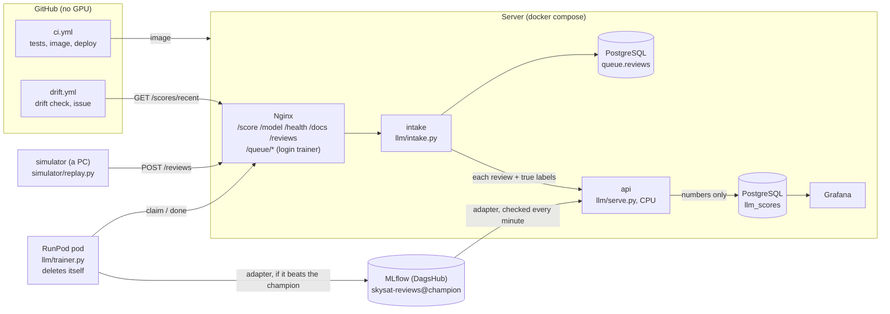

# SkySat architecture

The map of the project: the pieces, how they talk, which command starts what. Model details: [llm.md](llm.md).

## 1. What SkySat does

An airline gets thousands of free-text reviews. SkySat reads one and answers: score out of 10, recommended yes/no, main
complaint. The model is one LoRA adapter on a frozen 1.5B LLM. Passengers' reviews (simulated from the 128k dataset)
arrive at the server's **intake** and wait in a **queue**. A **trainer** on a rented **RunPod GPU** takes batches from
the queue, trains, gates, and registers in **MLflow**. The API serves the **champion**, logs every answer to
**PostgreSQL**, **Grafana** shows it, **drift** is checked on the live reviews' true labels. **CI/CD** tests and deploys.

## 2. The big picture

Ideas that hold it together:

- **The adapter is not inside the image.** The API asks MLflow which version is `champion` and loads it next to the base
  model it already has. A new model goes live without a redeploy.
- **The queue decouples arriving data from training.** Reviews keep arriving while nothing trains; a batch that fails
  goes back to pending.
- **The GPU is rented only while it trains.** `make train-remote` (or the intake with `AUTO_TRAIN=1`) starts a pod on
  the cheapest free GPU; the pod deletes itself when the trainer exits, and two timers delete it if it does not.
- **Review text stays private.** It is in the queue's own schema, which Grafana's user cannot read; monitoring stores
  numbers only.

## 3. The services (docker-compose.yml)

| Service | What | Port |
|---|---|---|
| `api` | `llm/serve.py`: base model + adapter, one review at a time, `mem_limit` 8 GB, base model cached in the `llm-models` volume | internal 8000 |
| `intake` | `llm/intake.py` (same image): `POST /reviews` -> queue, each live review to `api` with its true labels, `/queue/*` for the trainer | 127.0.0.1:8001 |
| `nginx` | gateway; routes `/score`, `/model`, `/health`, `/docs`, `/scores/recent`, `/reviews`; on the server also `/queue/*` for the `trainer` login | 8080 |
| `mlflow` | local registry (or the shared one from `.env`) | 5050 |
| `postgres` | `llm_scores` (`monitoring/init.sql`) and the schema `queue` | 5432 |
| `grafana` | dashboard `skysat`, anonymous read-only | 3000 |
| `k6` | `make d-loadtest`, 1 user for 1 minute against `/score` | on demand |

On the server, [docker-compose.server.yml](../docker-compose.server.yml) adds Caddy (HTTPS), the login, the rate limit,
the read-only Grafana database user and the restart policies ([server.md](server.md)).

## 4. Life of a model

1. `make simulate-seed N=2000`: 2,000 reviews flown <= 2018 go into the queue (not sent as live traffic).
2. `make train-remote` (RunPod, RTX 3070 at $0.13/h) or `make llm-train` (this PC): the trainer claims the newest pending
   reviews, keeps 10% back for the gate, and LoRA-tunes on the rest (1,800 reviews, 322 s on an RTX 4070 Laptop).
3. The gate (`llm/gate.py`): MAE <= 1.0, recommended >= 0.90, complaint >= 0.65. v1 from the queue: 0.88, 92.0%, 71.5%.
4. Logged to MLflow (parameters, metrics, the 17 MB adapter), registered as `skysat-reviews`; it becomes `champion` if
   no champion exists or it beats the champion on the same gate reviews (`combined`). The batch is marked trained.
5. The API sees the new alias within `MODEL_RELOAD_SECONDS`, loads the adapter, deletes the old one.
6. Drift: `make simulate ... SCENARIO=harsh` sends reviews a harsher survey scored; the live MAE rises past the gate,
   and the next batch (those newest reviews) trains a v2 that beats v1 on them.

## 5. Life of a request

`POST /reviews` → Nginx → `intake` → one row in `queue.reviews` (pending). The intake's loop sends it to `POST /score`
with its true labels → `api` (queues behind the lock, generates greedily, parses three lines) → answer (`score`,
`recommended`, `complaint`, `model_version`, `latency_ms`) → one row in `llm_scores` (numbers and fixed labels).
Malformed answers are `null` fields and count as wrong in the live measures.

## 6. CI, CD and the schedule

- `ci.yml`: pytest (no torch; the queue's SQL against a PostgreSQL service), `docker compose config` for both compose
  files, build the `llm/Dockerfile` image. On `main` it is pushed to ghcr.io and, if the server's runner and
  `DEPLOY_TO_RUNNER` are set, deployed and smoke-tested. The deploy job never runs for pull requests.
- `drift.yml`: `llm/drift_check.py` reads `/scores/recent`; on drift it opens the issue
  "Drift detected: retrain the LoRA adapter (make train-remote)". Its schedule is commented out until the final run.

## 7. Where things live

| What | Where |
|---|---|
| Review dataset | this PC (`data/reviews/`, gitignored); on the server only in the queue |
| Base model | Hugging Face, cached in the `llm-models` Docker volume (server) and on the pod's disk |
| Adapters, runs, metrics | MLflow (`artifacts/llm-runs/mlflow.db` locally, DagsHub when shared) |
| Prediction log | PostgreSQL `llm_scores` |
| Secrets | `.env` (local), `/opt/skysat/.env` and `gateway-users` (server), GitHub secrets, RunPod pod env; never in git |

## 8. Rules that shape the design

- No review text or prompt in git, images, MLflow or the monitoring table.
- Every number in the docs was measured (see [llm.md](llm.md)).
- A new adapter must beat the champion on the same reviews; otherwise the champion stays.
- A pod must never outlive its job: self-delete, an in-pod timer, and the launcher's deadline.

## 9. Known limits

- CPU serving takes seconds per review (15-24 s on a laptop) and handles one at a time, so live scoring lags behind a
  fast simulator; the API needs ~8 GB of RAM (the 1 GB server VM of the first version cannot host it).
- Real 2019-2022 drift does not hurt the model, so the drift demo uses the simulated `harsh` scenario.
- The pod clones the code from GitHub: a branch must be pushed before it can train on it.
- A review claimed for training before the intake has scored it is not scored any more.
