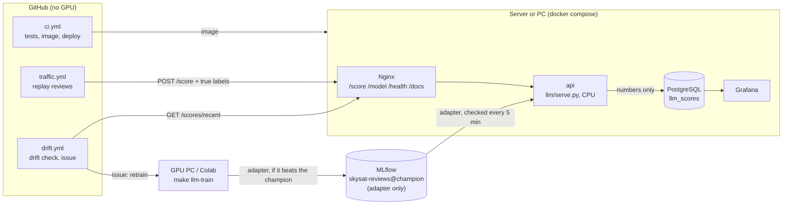

# SkySat architecture

The map of the project: the pieces, how they talk, which command starts what. Model details: [llm.md](llm.md).

## 1. What SkySat does

An airline gets thousands of free-text reviews. SkySat reads one and answers: score out of 10, recommended yes/no, main
complaint. The model is one LoRA adapter on a frozen 1.5B LLM. We train it on a GPU, gate it, keep it in **MLflow**,
serve the **champion** through an API, log every answer to **PostgreSQL**, watch it in **Grafana**, detect **drift**
and retrain. **CI/CD** tests and deploys the code.

## 2. The big picture

Ideas that hold it together:

- **The adapter is not inside the image.** The API asks MLflow which version is `champion` and loads it next to the base
  model it already has. A new model goes live without a redeploy.
- **Training is a person's job on a GPU.** GitHub only tests, builds, replays traffic and checks drift.
- **Monitoring stores numbers, never text.** The review dataset is not ours to store.

## 3. The services (docker-compose.yml)

| Service | What | Port |
|---|---|---|
| `api` | `llm/serve.py`: base model + adapter, one review at a time, `mem_limit` 8 GB, base model cached in the `llm-models` volume | internal 8000 |
| `nginx` | gateway; routes `/score`, `/model`, `/health`, `/docs`, `/scores/recent`, long read timeout | 8080 |
| `mlflow` | local registry (or the shared one from `.env`) | 5050 |
| `postgres` | table `llm_scores` (`monitoring/init.sql`) | 5432 |
| `grafana` | dashboard `skysat`, anonymous read-only | 3000 |
| `k6` | `make d-loadtest`, 1 user for 1 minute against `/score` | on demand |

On the server, [docker-compose.server.yml](../docker-compose.server.yml) adds Caddy (HTTPS), the login, the rate limit,
the read-only Grafana database user and the restart policies ([server.md](server.md)).

## 4. Life of a model

1. `make llm-train`: LoRA on 2,000 reviews flown <= 2018, ~5 min on an RTX 4070 (v1).
2. The gate (`llm/gate.py`) scores it on validation reviews: MAE <= 1.0, recommended >= 0.90, complaint >= 0.65.
3. Logged to MLflow (parameters, metrics, the 17 MB adapter), registered as `skysat-reviews`.
4. It becomes `champion` if no champion exists or it beats the champion on the same reviews (`combined`).
5. The API sees the new alias within `MODEL_RELOAD_SECONDS`, loads the adapter, deletes the old one.
6. Drift: under the `harsh` survey scenario v1 falls to MAE 1.18 / recommended 89.5% and fails the gate;
   v2, retrained on harsh 2019, gets MAE 0.41 / 95.5% and is promoted automatically.

## 5. Life of a request

`POST /score` → Nginx → `api` (queues behind the lock, generates greedily, parses three lines) → answer
(`score`, `recommended`, `complaint`, `model_version`, `latency_ms`) → one row in `llm_scores` (numbers and fixed labels; the
true labels if the caller sent them). Malformed answers are `null` fields and count as wrong in the live measures.

## 6. CI, CD and the schedule

- `ci.yml`: pytest (no torch), `docker compose config` for both compose files, build the `llm/Dockerfile` image. On `main`
  it is pushed to ghcr.io and, if the server's runner and `DEPLOY_TO_RUNNER` are set, deployed and smoke-tested.
  The deploy job never runs for pull requests.
- `traffic.yml`: replays live reviews (optionally under a drift scenario) to the server.
- `drift.yml`: `llm/drift_check.py` reads `/scores/recent`; on drift it opens the issue
  "Drift detected: retrain the LoRA adapter (make llm-cycle)".
- Both schedules are commented out (`# schedule:`) until the final run.

## 7. Where things live

| What | Where |
|---|---|
| Review dataset | your PC and a temporary GitHub runner only (`data/reviews/`, gitignored) |
| Base model | Hugging Face, cached in the `llm-models` Docker volume |
| Adapters, runs, metrics | MLflow (`artifacts/llm-runs/mlflow.db` locally, DagsHub when shared) |
| Prediction log | PostgreSQL `llm_scores` |
| Secrets | `.env` (local), `/opt/skysat/.env` and `gateway-users` (server), GitHub secrets; never in git |

## 8. Rules that shape the design

- No dataset row, review text or prompt in git, images, MLflow or PostgreSQL.
- Every number in the docs was measured (see [llm.md](llm.md)).
- A new adapter must beat the champion on the same reviews; otherwise the champion stays.

## 9. Known limits

- CPU serving takes seconds per review and handles one at a time; the API needs ~8 GB of RAM (the 1 GB server VM of the
  first version cannot host it).
- Real 2019-2022 drift does not hurt the model, so the drift demo uses simulated scenarios.
- Complaint accuracy (68%) is the weakest measure; the limit is 65%.
- Retraining and promotion are manual (GPU); the automatic part ends at the GitHub issue.
