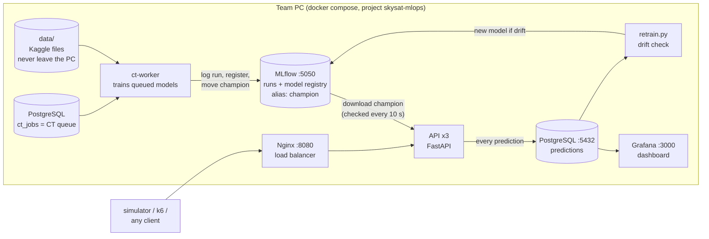
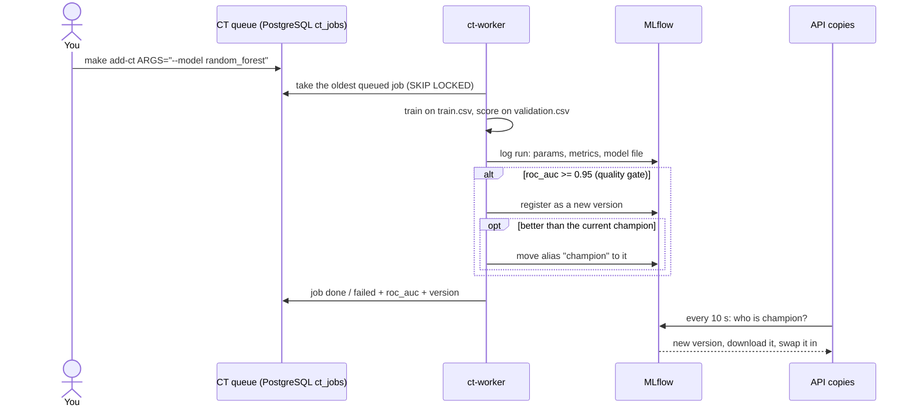
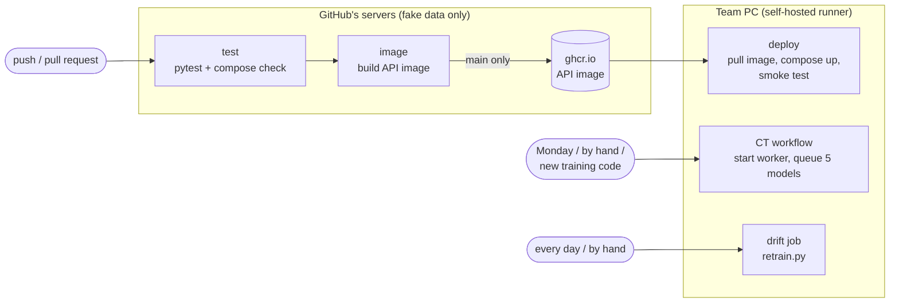

# SkySat architecture

This page is the map of the project: what the pieces are, how they talk to each other, and which command
starts what. The README has the details and measurements of every step; read this page first.

## 1. What SkySat does, in one paragraph

An airline wants to know, right after a flight, whether a passenger is **satisfied**. We train models on the
Kaggle passenger survey, keep every model in **MLflow**, serve the best one (the **champion**) through a
**prediction API**, log every prediction to **PostgreSQL**, watch the results in **Grafana**, detect when the
passengers start to look different (**drift**), and train new models (**CT**). **CI/CD** tests and deploys the
code. Everything runs in Docker on one PC.

## 2. The big picture



Two ideas hold it together:

- **The model is not inside the API.** The API asks MLflow "who is the champion?" every 10 seconds and
  downloads it when it changes. So a new model goes live **without restarting or redeploying anything**.
- **Training is a separate service.** You drop a job in a queue; a background worker trains it. Whoever adds
  the job (you, GitHub Actions, a cron job) does not wait and does not need to know how training works.

## 3. The services

| Service | What it is | Address | Code | Started by |
|---|---|---|---|---|
| `mlflow` | Experiment tracking + model registry | http://localhost:5050 | (image) | `docker compose up` |
| `api` (3 copies) | Answers `POST /predict`, `/feedback`, `/health`, `/model` | via Nginx | [api/](../api/) | `docker compose up` |
| `nginx` | Spreads requests over the 3 API copies | http://localhost:8080 | [nginx/](../nginx/) | `docker compose up` |
| `postgres` | Prediction log (`predictions`) and CT queue (`ct_jobs`) | localhost:5432 | [monitoring/init.sql](../monitoring/init.sql) | `docker compose up` |
| `grafana` | Dashboard on top of PostgreSQL | http://localhost:3000 | [monitoring/grafana/](../monitoring/grafana/) | `docker compose up` |
| `ct-worker` | Trains every job in the CT queue | (no port) | [training/ct_worker.py](../training/ct_worker.py) | `make start-ct` |
| `k6` | Load test | (no port) | [loadtest/](../loadtest/) | `docker compose --profile loadtest run --rm --no-deps k6` |

`ct-worker` and `k6` sit in Docker Compose **profiles**, so a plain `docker compose up` does not start them.

## 4. Life of a model



1. **Data** ([training/prepare_data.py](../training/prepare_data.py), `make data`): `data/train.csv` is split
   80/20 into `processed/train.csv` + `validation.csv`; `data/test.csv` becomes `live.csv` (traffic the models
   never saw).
2. **Train** ([training/train.py](../training/train.py)): one function, `run_training(train, validation, params)`,
   for every model type. `params["model"]` picks the type: `mlp` (PyTorch) or a scikit-learn model
   (`logistic_regression`, `random_forest`, `gradient_boosting`). The same file holds the preprocessing that the
   API uses, so training and serving cannot disagree.
3. **Register** ([training/track.py](../training/track.py) `register()`): the **quality gate** — a model is only
   registered if validation ROC AUC ≥ 0.95, and only becomes `champion` if it beats the current one.
4. **Serve** ([api/main.py](../api/main.py)): the API copies notice the new champion within ~10 s.
   `GET /model` tells you which version and which `model_type` is serving.

## 5. Life of a prediction

1. A client (the [simulator](../simulator/simulate.py), k6, or you in Swagger at http://localhost:8080/docs)
   sends a passenger to `POST /predict` on Nginx.
2. Nginx hands it to one of the 3 API copies. The copy checks the input against
   [skysat/schema.py](../skysat/schema.py), runs the champion, and answers `satisfied` + `probability`.
3. The copy writes the prediction to the `predictions` table.
4. Later the real answer arrives on `POST /feedback` and fills in `actual`.
5. Grafana reads the table: accuracy, ROC AUC, latency, requests per copy, model version over time.
6. [training/retrain.py](../training/retrain.py) compares the latest 2,000 predictions with the training data
   (**PSI** per feature). PSI ≥ 0.2 on any feature = drift → retrain the champion's model type on old + recent
   data, score both on the same recent holdout, promote only if better.

## 6. CI, CD and CT



| Loop | Question it answers | File |
|---|---|---|
| **CI** – continuous integration | "Does the code still work?" Tests on fake data, incl. training all 5 model types and the queue | [.github/workflows/ci.yml](../.github/workflows/ci.yml) `test`, `image` |
| **CD** – continuous deployment | "Is the newest code running?" Pushes the API image, the PC pulls it and restarts | [ci.yml](../.github/workflows/ci.yml) `deploy` |
| **CT** – continuous training | "Is the best possible model serving?" Queues the 5 candidates; the worker trains them | [.github/workflows/ct.yml](../.github/workflows/ct.yml) |

**Why some jobs run on our own PC:** the competition rules forbid giving the Kaggle data to anyone else,
GitHub included. So anything that needs real data (CT) or our running stack (CD) runs on a **self-hosted
runner**: a small GitHub program on the team PC that picks up those jobs. Jobs that only need code (CI) run on
GitHub's servers. Pull requests never run anything on the PC.

## 7. The CT queue in detail

The queue is just a table, `ct_jobs`, in the PostgreSQL that is already running
([training/ct_queue.py](../training/ct_queue.py)):

| status | meaning |
|---|---|
| `queued` | waiting for the worker |
| `running` | the worker is training it |
| `done` | trained; `roc_auc` is filled in, `model_version` too if it passed the gate |
| `failed` | something broke; `note` says what. The worker carries on with the next job |

```bash
make start-ct                                   # start the worker in the background (restarts if it crashes)
make add-ct ARGS="--model random_forest"        # queue one model
make add-ct ARGS="--model mlp --rating-one-hot --epochs 30 --name mlp-30-epochs"
make add-ct ARGS=--all                          # queue the 5 standard candidates
make list-ct                                    # what is queued / running / done
docker compose --profile ct logs -f ct-worker   # watch the worker live
make stop-ct                                    # stop it; a job in progress goes back to the queue
```

Why a table and not Redis or RabbitMQ: PostgreSQL is already there, and `SELECT … FOR UPDATE SKIP LOCKED`
makes it a safe queue (no job is ever taken twice). One worker is enough: training uses every CPU core, so two
workers on one PC would only slow each other down.

The 5 standard candidates: logistic regression (with one-hot ratings), random forest, gradient boosting, MLP,
MLP with one-hot ratings.

## 8. Where things live

```
api/            prediction API (FastAPI) + its Dockerfile
data/           Kaggle files (not in git, never in an image)
docs/           this page
loadtest/       k6 load test
monitoring/     PostgreSQL table + Grafana dashboard
nginx/          load balancer config
simulator/      sends live passengers (normal or "winter storm" drift) to the API
skysat/         shared code: schema (columns), data cleaning, drift (PSI)
training/       prepare_data, train, track (MLflow), retrain (drift), ct_queue + ct_worker (CT),
                compare, analysis/eda (charts), Dockerfile (ct-worker image)
tests/          pytest, fake data only
.github/        CI/CD (ci.yml), CT (ct.yml), smoke test
```

## 9. Rules that shape the design

- **Data never leaves the PC.** Not in git, not in a Docker image (`.dockerignore`), not in CI, not in MLflow
  (only counts and metrics are logged). The `ct-worker` *mounts* `data/` instead.
- **One model file format per type, one loader.** `model.pt` (PyTorch) or `model.joblib` (scikit-learn), both
  with the same metadata; `load_bundle()` reads either.
- **Every model is compared on the same validation rows** before it can become champion.

## 10. Words you will hear

| Word | Meaning here |
|---|---|
| **champion** | the MLflow alias for the model the API serves |
| **quality gate** | the rule "ROC AUC ≥ 0.95 or it is not registered" |
| **ROC AUC** | 0.5 = guessing, 1.0 = perfect ranking of satisfied vs. not satisfied |
| **drift** | live passengers start to look different from the training data (e.g. a winter storm) |
| **PSI** | Population Stability Index: how much one feature's distribution moved; ≥ 0.2 = drift |
| **job queue / worker** | producers put work in a list; a background process takes it out and does it |
| **self-hosted runner** | GitHub's job runner installed on our own PC |
| **profile** (Compose) | services that only start when you ask for them (`--profile ct`) |
