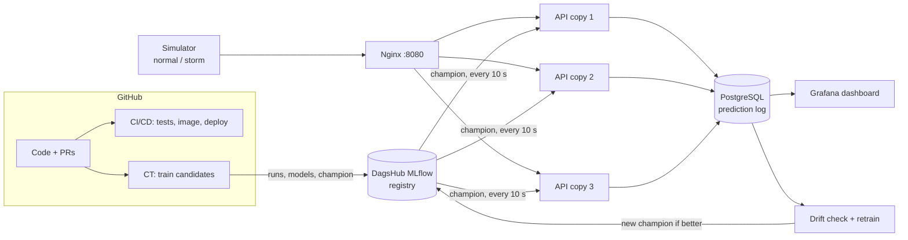

# SkySat – Presentation

SE4458 Assignment 1 · Topic: **MLOps – build a simple ML model and demonstrate its complete lifecycle from
training to production** · Team: Bermal Deniz Akkaya, Osman Şahin Güler · Code: https://github.com/deensza/skysat-mlops

What the assignment asks for, and where it is answered:

| Requirement (Demo Instructions) | Where |
|---|---|
| Motivation for the topic | slides 2–3 |
| Architecture | slides 4–5, [architecture.md](architecture.md) |
| Brief document / presentation with the public GitHub link | this file (slides are built from it) |
| A RUNNING code example | slide 11 + the video, [demo/video.md](../demo/video.md) |

Open points (tick when done):

- [ ] Build the slides from this file (one `##` = one slide; speaker notes under each)
- [ ] Re-measure the numbers marked *(re-check)* on the final stack before presenting
- [ ] Record the video ([demo/video.md](../demo/video.md)) and put its link on slide 11
- [ ] Upload slides (with the GitHub link) and code to Moodle
- [ ] Decide on CD: switch on the deploy step (self-hosted runner on one PC) or present it as "built, off" (slide 10)
- [x] At the end: merge `osm` into `main` → CT on GitHub trains the 9 candidates (incl. `ensemble`, local
      validation ROC AUC 0.99605, logit-averaged) on DagsHub → both rebuild the API image (`make d-build`) → update slide 6
      with the new champion. Not before: `main`'s code cannot load an ensemble (same failure as the LightGBM
      champion, slide 12). Done 2026-10-30: ensemble = champion v36 (0.9960). Each PC: `git pull`, `make d-build`
- [ ] Rehearse once with a timer (target: ~10 min slides + 3 min video + questions)

---

## 1. SkySat: an airline satisfaction model, from notebook to production

- Predict whether an airline passenger is **satisfied**, from 22 answers (flight, delays, service ratings)
- The model is the easy part; the project is **everything around it**
- Public code: github.com/deensza/skysat-mlops

> Notes: introduce the team and the one-sentence goal. Say up front that the model itself is simple on purpose:
> the topic is the lifecycle, not the algorithm.

## 2. Motivation: why do we need MLOps?

- A model in a notebook helps nobody; it must be **served, watched and replaced**
- Typical failures without MLOps:
  - "It worked on my machine": different data, packages or settings
  - Nobody knows which model is in production or how it was trained
  - The world changes (**drift**), accuracy drops silently
  - Retraining is manual, so it does not happen
- MLOps = DevOps ideas (automation, CI/CD, monitoring) **plus** data and models as versioned things

> Notes: one concrete example: a satisfaction model trained in summer meets a winter storm: delays explode,
> ratings drop, the model keeps answering confidently and is wrong more often. Nobody notices without monitoring.

## 3. What kind of problems is MLOps good for?

- Any model that is **used repeatedly** on new data: recommendations, fraud, demand, churn, satisfaction
- When the data **changes over time** and the model must keep up
- When a **team** trains models and must agree on which one is "the" model
- Not needed for a one-off analysis that is read once

> Notes: the assignment's Firebase example asks "what sort of apps is it good for". This is our answer for MLOps.

## 4. The lifecycle we built

```
data → training → tracking & registry → packaging → serving → scaling → monitoring → drift → retraining
                                   ↑                                                        │
                                   └──────────────── CI / CD / CT (automation) ─────────────┘
```

| Stage | Tool | Why this tool |
|---|---|---|
| Data prep + traffic simulator | Python, pandas | clean split; fake "live" passengers, incl. a storm |
| Training | PyTorch, scikit-learn, LightGBM, XGBoost | 11 model types, same preprocessing code |
| Experiment tracking + model registry | **MLflow** (shared on **DagsHub**) | every run logged; one `champion` alias |
| Packaging | **Docker**, Docker Compose | the same image on every machine |
| Serving | **FastAPI** | `/predict`, loads the champion, swaps in a new one without restart |
| Scaling + load test | **Nginx** (3 API copies), **k6** | load balancing; measured throughput |
| Monitoring | **PostgreSQL** + **Grafana** | every prediction logged; live accuracy dashboard |
| Drift + retraining | PSI per feature, MLflow | detect the storm, retrain, promote if better |
| CI / CD / CT | **GitHub Actions** | tests, image build, deploy, training on GitHub's machines |

> Notes: walk left to right once. Each later slide zooms into one box.

## 5. Architecture



> Notes: two loops: the **training loop** (GitHub → DagsHub) and the **serving loop** (simulator → API → log →
> Grafana). Drift detection connects them: production data goes back into training. Full description:
> [architecture.md](architecture.md).

## 6. Training and model selection

- Same data split for every model: 83,123 training rows, 20,781 validation rows (never used to choose settings)
- 9 standard candidates trained by CT; the **quality gate**: register if ROC AUC ≥ 0.95, `champion` only if it
  beats the current champion **re-scored on the same rows**

| Model | Validation ROC AUC (3 seeds) |
|---|---|
| ensemble: tuned gradient boosting + tuned LightGBM + tuned MLP, logits averaged | **0.9960** (champion, v36) |
| gradient boosting, tuned by 5-fold CV on training rows only | 0.9958 (champion v8 before) |
| LightGBM | 0.9957 |
| XGBoost | 0.9955 |
| MLP (PyTorch), one-hot ratings | 0.9954 |
| gradient boosting, defaults | 0.9951 |
| MLP | 0.9948 |
| random forest | 0.9941 |
| logistic regression | 0.9807 |

- The top four are within 0.0004: about the size of the noise. Honest reporting matters more than the 4th decimal.

> Notes: the majority-class baseline is 0.567 accuracy, so 0.99 ROC AUC is not "free". Mention that tuning used
> cross-validation on the training rows only; the validation rows were scored once at the end.

## 7. Experiment tracking and the model registry (MLflow on DagsHub)

- Every training run: parameters, 7 metrics, git commit, the model file
- Registry: every model that passes the gate becomes a new version of `skysat-satisfaction`; the API asks for
  **`@champion`**, never a version number
- Shared on DagsHub, so both team members and GitHub's CT machines see the same runs and the same champion

> Notes: show DagsHub in the video (scene 1). Point: changing the champion changes production without a code
> change or redeploy.

## 8. Serving and scaling

- FastAPI: `POST /predict` → satisfied yes/no, probability, model version, which copy answered
- 3 API copies behind Nginx (round robin). k6, 50 virtual users for 30 s:

| API copies | Requests/s | p95 latency | Errors |
|---|---|---|---|
| 1 | 356 | 182 ms | 0 |
| 3 | 856 (2.4×) | 137 ms | 0 |

*(Measured on a MacBook Pro M1; re-check)*

> Notes: lesson learned: a first "1 copy" test silently ran with 3 copies (Docker Compose restarted them).
> Measuring the wrong thing is easy; check what you measure.

## 9. Monitoring and drift

- Every prediction goes to PostgreSQL; the simulator later sends the passenger's real answer → **accuracy in
  production**, not only on a test set
- Grafana: model version, predictions, accuracy and ROC AUC over time, requests per copy, latency
- Drift check: Population Stability Index (PSI) of every feature vs. the training data; drift = PSI ≥ 0.2

| Phase | Serving version | Accuracy (real answers) |
|---|---|---|
| Normal traffic | 1 | 96.25% |
| Winter storm, before retraining | 1 | 91.75% |
| Winter storm, after retraining (new passengers) | 2 | 94.75% |

- Storm: PSI 0.44–1.32 on exactly the 9 features the storm changes, ≤ 0.004 on the other 13

> Notes: this is the core story of the demo video (scene 3). "The model degrades, the system notices, retrains
> itself and recovers."

## 10. CI / CD / CT on GitHub Actions

- **CI** (every push / PR): tests on **fake data** (incl. training every model type), Docker Compose check, API
  image build
- **CD** (on `main`): the API image is pushed to GitHub's registry (ghcr.io). The deploy step (pull the image on
  a team PC, restart, smoke-test through Nginx) is written but **switched off**: it needs a self-hosted runner,
  and the last `main` run shows `deploy: skipped`
- **CT** (on request + when training code lands on `main`): trains the candidates on GitHub's machines → DagsHub; works with our PCs off
- Competition data never leaves our PCs: CI uses synthetic passengers, CT downloads the public original dataset

> Notes: good place for a real story, slide 12.

## 11. Live demo (video, ~3 min)

1. DagsHub: the candidates, their scores, the champion
2. One prediction through Nginx; Grafana with normal traffic
3. Winter storm → accuracy drops → drift detected → retrain → new champion → accuracy recovers

Video: *(link)* · Script: [demo/video.md](../demo/video.md)

## 12. What went wrong, and what we learned

- **A model in the registry must be loadable by production code.** A LightGBM model became the shared champion
  while LightGBM was not yet in the main code; the next CT run and new API copies could not load it. Fix: dependencies
  pinned, the champion replaced by a model the code could load, and a rule: merge the code before a model can become
  the shared champion.
- **Configuration decides where things go.** `make` reads `.env`, so a "local" run went to the shared MLflow.
  The demo now runs in its own Docker project with the shared settings switched off.
- **Check what you measure**: the load test that was not testing 1 copy (slide 8); seed-to-seed noise vs. "better".

> Notes: teachers like honest failure stories, and this is exactly what MLOps exists to prevent.

## 13. Bonus: the Kaggle competition track

- Same dataset family: Kaggle Playground S6E10 *Predicting Airline Satisfaction* (metric ROC AUC)
- Separate pipeline (other columns; data must stay on our PCs): 5-fold CV, logged to MLflow, every submission
  traceable by its sha256
- CV ROC AUC 0.96013 ± 0.00053 (gradient boosting + LightGBM + satisfied-share inputs from the original dataset; was 0.95853) *(add the public score)*

Video: [Google Drive](https://drive.google.com/drive/folders/1WBdX3AQdVqQV6cO-wTW8shrivhatKatB) · Script: [demo/kaggle-video.md](../demo/kaggle-video.md)

## 14. Summary and questions

- Built: a simple model with the **full lifecycle**: tracked, registered, packaged, served, scaled, monitored,
  drift-aware, retrained, automated
- Code and docs: github.com/deensza/skysat-mlops · Data: Kaggle Playground S6E10 (CC BY 4.0) and the original
  Airline Passenger Satisfaction dataset

### Likely questions (prepare an answer)

- Why MLflow and not Weights & Biases? (open source, self-hostable, registry with aliases, DagsHub hosts it free)
- Why PSI for drift? What threshold and why 0.2?
- What happens if MLflow is down? (API keeps the model it has and retries; logging failure never breaks serving)
- How do you stop a worse model from going to production? (quality gate, same rows for both models)
- Why 3 API copies and not 10? (CPU-bound; measured scaling)
